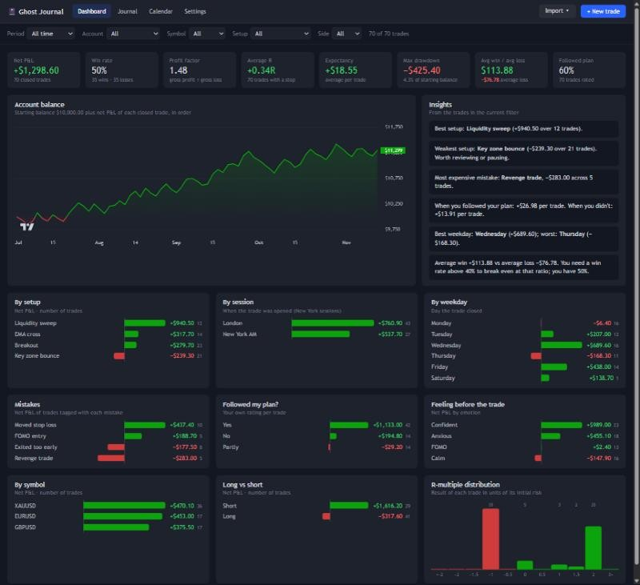
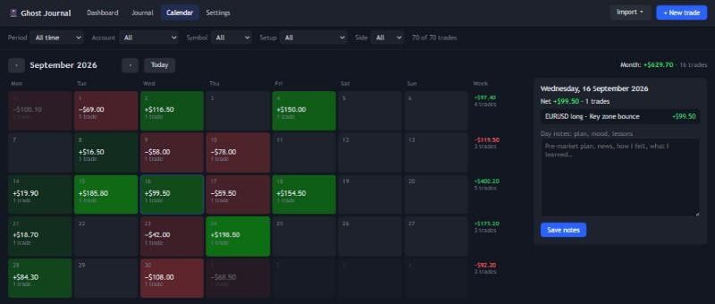

# 📓 Ghost Journal

A free, private **trading journal** that runs on your own computer, with a dashboard to review your trading.
Log trades by hand or import them from **MetaTrader 5**, tag your setups, emotions and mistakes, paste chart
screenshots, and see what actually makes or costs you money.





*Screenshots use made-up sample trades.*

## Features

- **Trade log**: symbol, side, times, lots, entry/exit, stop loss, take profit, fees, exit reason, timeframe.
  P&L is calculated for you from the contract size if you leave it blank; R-multiple and planned reward:risk are shown as you type
- **Review fields**: setup, feeling before/after, *followed my plan?* (yes / partly / no), mistake tags, 1–5 execution rating, notes
- **Screenshots**: paste with Ctrl+V, drag and drop, or choose files; click to enlarge
- **Import from MetaTrader 5**: closed trades from the logged-in account, including stop loss and take profit. Safe to re-run; duplicates are skipped
- **Import [Ghost Charts](https://github.com/GhostInTheWeights/GhostCharts) backtests** (its trades CSV) into a separate "Backtest" account
- **Dashboard**: net P&L, win rate, profit factor, average R, expectancy, max drawdown, average win vs loss, plan adherence,
  balance curve, automatic insights, and P&L by setup, session, weekday, mistake, plan-followed, emotion, symbol and side,
  plus the R-multiple distribution. Hover any bar for details
- **Calendar**: daily P&L heat-map with weekly and monthly totals, plus **day notes** for your plan, mood and lessons
- **Filters** for period, account, symbol, setup and side across every view
- **Export** everything to CSV
- Your data stays on your computer: one SQLite file plus an images folder. Nothing is uploaded anywhere

---

## Prerequisites

| # | What | Why | Needed for |
|---|---|---|---|
| 1 | **Python 3.9 or newer** | Runs the small local server that stores your journal | Everything |
| 2 | A modern browser (Chrome, Edge, Firefox) | The app's interface | Everything |
| 3 | Internet connection | The balance chart library loads from a CDN | Balance chart |
| 4 | **MetaTrader 5** desktop + `MetaTrader5` Python package (Windows) | Reading your trade history | MT5 import only |

### 1. Install Python

1. Download it from <https://www.python.org/downloads/>.
2. Run the installer and **tick "Add python.exe to PATH"** on the first screen.
3. Check it works: press `Win + R`, type `cmd`, press Enter, and run `python --version`.

### 2. Get Ghost Journal

**Download ZIP (easiest):** on this page click the green **Code** button → **Download ZIP**, then right-click the ZIP → *Extract All*.

**Or with Git:**
```
git clone https://github.com/GhostInTheWeights/Ghost-journal.git
```

### 3. (Optional) MetaTrader 5 import

Only if you want to import trades from MT5. Open a command prompt in the Ghost Journal folder and run:
```
pip install -r requirements.txt
```
Then keep the MetaTrader 5 desktop app open and logged in when you import.

---

## Running it

1. Double-click **`start.bat`** (or run `python server.py` and open <http://localhost:8766>).
2. A black **"Ghost Journal server"** window opens. Keep it open while you use the app, and close it to stop.
3. Go to **Settings** first: set your starting balance, your own setups, mistake tags and emotions, and the contract sizes of the symbols you trade.

> Don't open `index.html` directly; it needs the server to save your trades. Always use `start.bat`.

## Daily routine (what makes the dashboard useful)

1. After trading, click **Import ▾ → From MetaTrader 5**, or **+ New trade** to log by hand.
2. Open each new trade in the **Journal** tab and fill in setup, *followed my plan?*, mistakes and a screenshot.
3. In **Calendar**, click today and write a few lines: plan, mood, lesson.
4. Once a week, read the **Dashboard** insights. After 20–30 trades they show which setups and habits pay and which cost you.

## Your data and backups

Everything lives in the `data/` folder next to the app:

- `data/journal.db`: all trades, settings and day notes (SQLite)
- `data/images/`: your screenshots

To back up, copy the `data` folder. To move to another computer, copy it into the new install.
`data/` is in `.gitignore`, so it is never committed to Git.

## Troubleshooting

| Problem | Fix |
|---|---|
| `'python' is not recognized` | Re-run the Python installer → *Modify* → tick "Add Python to environment variables". |
| `The MetaTrader5 Python package is missing` | Run `pip install -r requirements.txt` in the Ghost Journal folder. |
| `Could not connect to MetaTrader 5` | Open the MT5 desktop app and log in, then import again. |
| Imported times are off by a few hours | Set *MT5 server time offset* in Settings (many brokers run on UTC+2 or UTC+3; Exness is UTC). |
| P&L stays empty | Enter it yourself, or add the symbol's contract size in Settings (e.g. `XAUUSD = 100`). |
| Port 8766 already in use | Ghost Journal is already running in another window. Use that one or close it. |

## How it works

| File | Purpose |
|---|---|
| `index.html`, `style.css` | Layout and styling |
| `app.js` | Journal, trade form, dashboard, calendar, settings |
| `server.py` | Local web server (127.0.0.1 only), SQLite storage, image uploads, MT5 and CSV import |
| `start.bat` | Double-click launcher |

Definitions: **Net P&L** = P&L − fees. **R** = (exit − entry) ÷ (entry − stop), so it needs a stop loss.
**Sessions** use New York time: Asia 18:00–03:00, London 03:00–08:00, NY AM 08:00–12:00, NY PM 12:00–17:00.

## Disclaimer

**Not financial advice.** Ghost Journal is a record-keeping and self-review tool. Its statistics and insights describe
your past trades only and do not predict future results.

**Your data, your responsibility.** Trade history is read from your own MetaTrader 5 terminal and stored only on your
computer. Check imported figures against your broker statements; their accuracy depends on your broker.

**Independent project.** Not affiliated with or endorsed by MetaQuotes or TradingView. MetaTrader and TradingView are
trademarks of their respective owners.

## Credits

Balance chart by [TradingView Lightweight Charts](https://github.com/tradingview/lightweight-charts) (Apache-2.0).
Released under the [MIT License](LICENSE).
